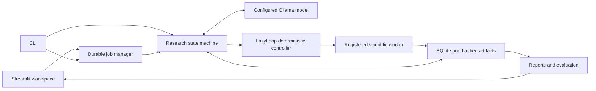

# Architecture

SlothLab is a local, single-user research application with five independent layers. The browser and CLI share the same validated configuration, scientific engine, persisted evidence, and termination rules. The frontend is optional.

## Contracts and authorization

`schemas.py` defines strict Pydantic contracts for objectives, hypotheses, experiments, results, decisions and sessions. Extra keys, non-finite numerical values, and invalid parameter types are rejected. Application-generated identity, session ownership and creation timestamps are authoritative; model generation supplies scientific choices, not persistence metadata.

`config.py` validates finite parameter authorizations, optional numerical bounds, allowed phases, estimated-cost limits, replication-group requirements, disjoint exploratory/confirmatory seed sets, budgets and structured success criteria. Unsupported constraint/criterion keys fail explicitly. Arbitrary scientific prose remains a question to investigate rather than an automatically certified completion predicate.

## Research loop and criticism

`agent/orchestrator.py` implements explicit persisted states: initialized, hypothesizing, planning, validating, executing, analyzing, replanning and terminal completed/stopped/failed. A checkpoint precedes resource-consuming calls. Each call reserves a conservative input-byte/output allowance; known telemetry reconciles the charge and missing/failed telemetry remains unknown. Output repairs, proposals, planning rounds, experiments, tokens and wall time all have finite bounds.

`agent/planner.py` provides compact, context-specific JSON schemas rather than asking a model to invent internal IDs and metadata. It exposes authorized choices, correlates seeds with phase, tracks already attempted scientific actions, and carries relevant observations and the latest evidence-based research direction. Equivalent text is not a redundancy proof; scientific identity is structural.

The analyst can propose an explicitly recorded hypothesis revision after contradictory evidence. A revision requires valid result references and a complete falsifiable prediction, creates an untested hypothesis, and preserves the prior hypothesis/history. `agent/critic.py` verifies only declared numerical delta directions under identical conditions with sufficient independent measurements. General natural-language assertions are not promoted into established claims by model confidence.

`lazyloop/stopping.py` evaluates predeclared operational targets separately from model opinion. A final confirmation batch uses reserved independent seeds and ends planning. Interrupted final batches are completed/reconciled before the completion check, preventing resumed work from optimizing against held-out observations.

## LazyLoop

The controller validates every proposal before execution. Hard authorizations and remaining budgets override priority. Exact completed results pass integrity checks before reuse; different seeds remain distinct replications, associated with a shared group. A newly linked cached result can trigger analysis, while re-reading already known evidence is not scientific progress.

Candidate priorities follow the specified normalized heuristic: information value, novelty, relevance, feasibility and a configurable cost penalty. Components and reasoning are persisted with each decision. Full LazyLoop ranks candidates and detects repeated unproductive planning; cache-only adds exact reuse without full ranking/stopping optimization; baseline uses the same scientific tools and hard safety limits without reuse optimization.

## Execution boundary

`experiments/registry.py` allowlists trusted procedures. `executor.py` validates the spec again, generates a bounded artifact directory from application identity, invokes a fixed worker with an argument array, minimizes inherited environment variables, enforces a wall timeout and verifies outputs. Workers apply Linux CPU/address-space limits and Python socket/child-process guards. Actual runtime and supported CPU/memory telemetry are recorded.

`experiments/isolation.py` probes rootless Bubblewrap. With an available backend, private namespaces remove network access and unrelated host files; runtime/package mounts are read-only and the experiment directory is writable. `auto` records an explicit restricted-subprocess fallback when the host cannot support this boundary. Strict `bubblewrap` fails closed. A plain subprocess has ordinary OS permissions and is not described as a hardened sandbox. Only registered trusted functions are supported in either mode.

A successful worker produces an atomic `result.json` receipt plus parameter/data artifacts and hashes. Resume can reconcile a fully committed, matching receipt without repeating execution. Incomplete, mismatched or unverified output never becomes a successful cache hit.

## Memory, jobs and concurrency

SQLite uses transactional writes, foreign keys and WAL. Objectives, result/spec identities, session ownership and hard budgets preserve history. Tables retain sessions, hypotheses, specifications, results, evidence links, decisions, events, state transitions and budget charges. Large arrays and exports remain in the artifact tree.

`runtime/jobs.py` starts bounded detached workers and writes atomic job metadata. PID plus process creation time prevents stale metadata from signaling a reused PID. Manager/metadata locks coordinate start, pause and completion; per-session `flock` locks reject concurrent investigators and release on process exit. Browser refresh and server restart do not erase jobs or scientific checkpoints.

SIGTERM requests a resumable pause. A hard exit is reconciled as a failed/stopped job while the scientific checkpoint and charged work remain inspectable. A nonterminal session can resume; terminal sessions are not silently restarted. Global elapsed wall time includes interruption time, so a resumed session can legitimately discover that its budget has expired.

## Reporting, evaluation and UI

Reports use persisted evidence only and export Markdown, standalone printable HTML, CSV and JSON with result references, scientific configuration, source/environment metadata, hashes, decisions and termination reasons. Free-form model prose is escaped in HTML/browser views.

The evaluation runner gives each baseline/cache-only/LazyLoop arm cold storage, records identical constraint signatures, counterbalances arm order, and pairs disjoint trial seed partitions. Seven bundled scenarios cover control, shift, sample-size, miscalibration, replication, repeated proposals and mixed outcomes. Scientific integrity/control/claim checks and seed coverage are separately reported from compute. Independent reference grids are withheld from planning and verified against their stored measurements before final comparison.

The Streamlit workspace uses durable job APIs, periodically reads actual SQLite checkpoints, exposes browser configuration/start/pause/resume/export, and renders measured plots/comparisons. It loads no external fonts, assets or analytics. The CLI binds the browser server to loopback and disables Streamlit usage-stat collection. Multi-user authentication and public hosting are outside the original MVP boundary.

See [operations](operations.md) for deployment and recovery, [evaluation](evaluation.md) for rubric limits, and [verification](verification.md) for actual measured evidence and current validation.
