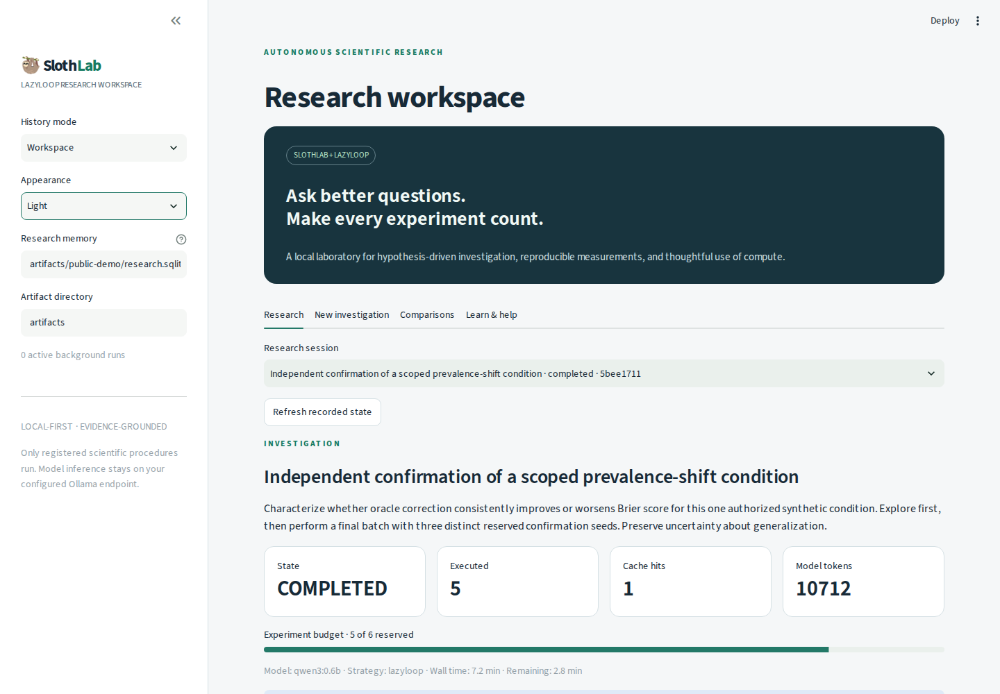

# SlothLab live app demo

**[Watch on YouTube](https://youtu.be/UV3h4IRk3go)** · [Interactive static demo](https://mso-docs.github.io/LazyLab/) · [Video help page](https://mso-docs.github.io/LazyLab/help.html)

**[Watch or download the live demo (MP4)](media/slothlab-live-demo.mp4)** · [English captions (VTT)](media/slothlab-live-demo.vtt) · [Full transcript](media/slothlab-live-demo-transcript.md)

This is an actual recording of the Streamlit application operated automatically in an isolated Chromium browser. It shows real navigation, measured results from a previously completed investigation, a real portable-bundle download, and reopening that history in Guest mode. It does not start a new research investigation or replay a model run in real time. The silent video includes separate English captions and a readable transcript.

The completed investigation has five original executions, one verified reuse, and three independent confirmation seeds. Its findings apply to its recorded synthetic condition and finite protocol. The video keeps that limitation visible.

## Walkthrough

| Time | Chapter |
| --- | --- |
| 0:00 | Welcome |
| 0:06 | Dark appearance |
| 0:12 | Design a question |
| 0:19 | Local or remote AI |
| 0:24 | Finite research budgets |
| 0:31 | Recorded measurements |
| 0:38 | Experiment history |
| 0:45 | Evidence and uncertainty |
| 0:54 | Portable export |
| 1:01 | Guest without SQL |
| 1:08 | Reopened guest history |
| 1:15 | Interactive learning |
| 1:21 | Research design checklist |
| 1:30 | Remembered local profile |

If your repository viewer cannot play the linked MP4 inline, download it and open it in a video player. Load the VTT as subtitles where supported. The transcript supplies the same guidance without video playback.

## Recording and privacy

The browser used a separate copy of the demonstration workspace, relative local paths, and a demonstration profile name. No personal browser profile, desktop, microphone, or notifications were captured. Raw attempts, screenshots, chapter timings, and the exported research bundle remain in ignored `artifacts/`. The published files are the reviewed final recording, poster, captions, and transcript.

The recording was checked scene by scene, and the entire final MP4 was decoded successfully. The automated walkthrough completed its bundle download, guest restore, and local-profile creation without errors.

See [automated recording setup](recording.md) to reproduce it without manually operating the browser. The earlier [90-second illustrated overview](illustrated-demo.md) remains available separately; the application's **Learn & help** area also contains the interactive research lesson.
