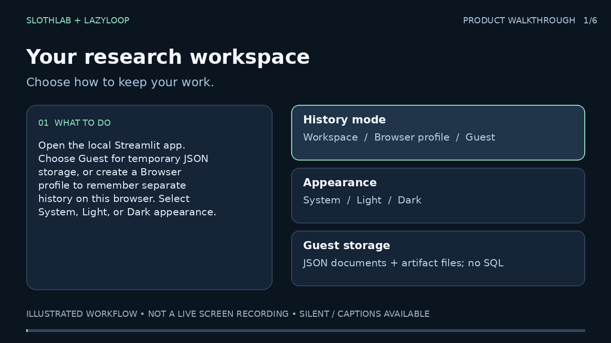

# SlothLab demo

[](media/slothlab-demo.mp4)

**[Watch or download the demo (MP4)](media/slothlab-demo.mp4)** · [English captions (VTT)](media/slothlab-demo.vtt) · [Full transcript](media/slothlab-demo-transcript.md)

A 90-second, silent, 720p illustrated product walkthrough. This is an animation of the workflow, not a live screen recording or evidence of a completed scientific run. If your repository viewer does not play the linked MP4 inline, download it and open it in a video player. Load the VTT file as subtitles where supported; the transcript contains the same guidance.

| Time | Chapter |
| --- | --- |
| 0:00 | Choose a local profile or guest workspace and appearance |
| 0:15 | Write a testable research question |
| 0:30 | Define controls, confirmation seeds, and budgets |
| 0:45 | Monitor measurements, decisions, and pause/resume |
| 1:00 | Interpret results and preserve guest history |
| 1:15 | Connect local or remote AI and find help |

For a hands-on walkthrough, start `slothlab dashboard`, open `http://127.0.0.1:8501`, and follow these chapters. **Learn & help** provides a separate interactive research lesson and practice questions.

The demo uses only public instructional text, illustrative cards, and local fonts. It contains no personal profile, browser session, credentials, or private research data. Keep these intentional documentation assets in Git; generated personal research exports remain ignored.

To rebuild, install Pillow in your development environment and run:

```bash
python scripts/build_docs_demo.py /path/to/ffmpeg
```

The generator writes the MP4, poster, captions, and transcript under `docs/media/`. A development-only contact sheet is written to `/tmp` for visual review. Playback does not require Pillow or ffmpeg.
